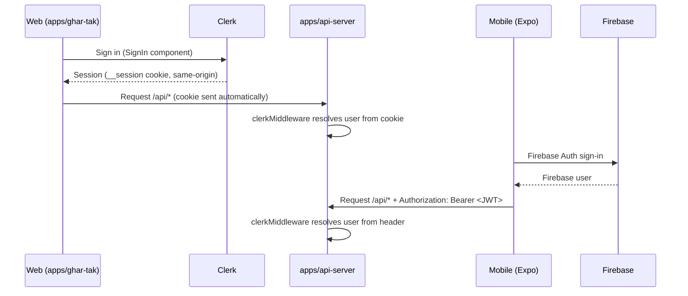
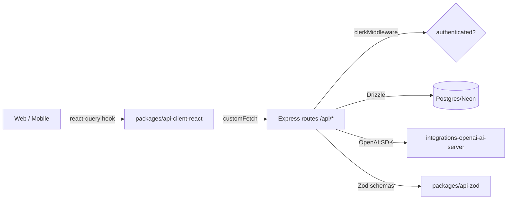

# Ghar-Tak – Data & Application Flow

This document traces how data moves through the Ghar-Tak monorepo: auth, API calls, persistence, AI integrations, and the client apps. It complements the architecture overview in `PROJECT_DOCUMENTATION.md`.

## Core Structure

```
Ghar-Tak/
├─ apps/
│  ├─ api-server/       # Express REST API — the only backend
│  ├─ ghar-tak/         # Web app (React + Vite) — Clerk auth, mock-data fallback
│  ├─ ghar-tak-mobile/  # Expo app — Firebase Auth, Supabase + API client
│  ├─ ghar-tak-promo/   # Promo site
│  └─ mockup-sandbox/   # Design sandbox
├─ packages/
│  ├─ db/                             # Drizzle schema + Postgres (Neon)
│  ├─ api-spec/                       # OpenAPI 3.1 (packages/api-spec/openapi.yaml)
│  ├─ api-zod/                        # Zod schemas generated from the spec
│  ├─ api-client-react/               # orval-generated react-query client + custom fetch
│  └─ integrations-openai-ai-server/  # OpenAI AI server integrations
└─ scripts/
```

## Auth Flow



- **Web** relies on the same-origin `__session` cookie. `ApiClientAuthSync` in `apps/ghar-tak/src/App.tsx` calls `setAuthTokenGetter`, but on web the cookie is what actually authenticates; the "missing bearer token" log is a false positive.
- **Mobile** calls `setAuthTokenGetter(() => session.getIdToken())` and `setBaseUrl(<api origin>)` so every generated-client request carries the token.

## API Request Flow



1. Pages/components call generated hooks (e.g. `useListProviders`) from `@workspace/api-client-react`.
2. The orval-generated client builds a request with `customFetch` (see `packages/api-client-react/src/custom-fetch.ts`), which:
   - prepends the configured `baseUrl` (`/api` on web, remote origin on mobile);
   - attaches a bearer token only when a getter is registered (mobile);
   - throws `ApiError` on non-2xx responses;
   - throws `ResponseParseError` when a 2xx body is HTML (e.g. Vite SPA fallback served when the API is down) so the UI never `.map()`s an HTML string.
3. `apps/api-server/src/app.ts` mounts `clerkMiddleware` (cookie/header → user), then the `/api` router (`apps/api-server/src/routes/*`).
4. Routes validate with Zod and persist via Drizzle (`packages/db`).
5. Responses flow back through TanStack Query cache into React state.

## Data Persistence

- All core entities live in `packages/db/src/schema/` (`users`, `sessions`, `providers`, `products`, `services`, `orders`, `reviews`, `subscriptions`, `contact_messages`, `conversations`, `messages`).
- `packages/db/src/index.ts` exports a shared `pool` and Drizzle `db` and throws if `DATABASE_URL` is unset.
- Subscription plans are **hardcoded** in `apps/api-server/src/routes/plans.ts` (starter / growth / pro), not stored in the DB.

## Web App Degradation & Fallback

- `apps/ghar-tak/src/context/DataContext.tsx` seeds UI state from `src/lib/mock-data` (mock stores/products/service categories) so the site renders useful content even when the API is unreachable.
- Pages defensively guard API results with `Array.isArray(...)` before `.map()` / `.slice()` (see e.g. `components/sections/NearbyProvidersSection.tsx`).
- Supabase is used as a **read-only fallback data source** in `apps/ghar-tak/src/lib/db.ts` (schema in `supabase/schema.sql`, anon read-only RLS).

## AI Integrations

`@workspace/integrations-openai-ai-server` wraps the OpenAI client (configured via `AI_INTEGRATIONS_OPENAI_BASE_URL` / `AI_INTEGRATIONS_OPENAI_API_KEY`). The API exposes:

- `POST /api/ai/analyze-image` — analyze an image (image-analyzer page).
- `POST /api/ai/describe-image` — describe an image.
- `POST /api/ai/chatbot` — chat assistant.
- `POST /api/ai/recommendations` — personalized suggestions (all `requireAuth`).

## API Client Regeneration

`packages/api-spec/orval.config.ts` generates, from `packages/api-spec/openapi.yaml`:

- `packages/api-zod` — Zod request/response schemas (mode `split`).
- `packages/api-client-react` — react-query hooks + `custom-fetch` mutator (baseUrl `/api`).

After editing the spec, regenerate both before using the new endpoints.

## Where Code Lives

| Component | Location |
|-----------|----------|
| Express app / middleware | `apps/api-server/src/app.ts` |
| API routes | `apps/api-server/src/routes/*.ts` |
| Drizzle schema | `packages/db/src/schema/*.ts` |
| OpenAPI spec | `packages/api-spec/openapi.yaml` |
| Generated client | `packages/api-client-react` (consumed from `./src`, no build step needed) |
| Zod schemas | `packages/api-zod` |
| OpenAI integration | `packages/integrations-openai-ai-server` |
| Web pages / context | `apps/ghar-tak/src/pages`, `apps/ghar-tak/src/context` |
| Mobile auth / supabase | `apps/ghar-tak-mobile/lib/{auth.tsx,firebase.ts,supabase.ts}` |
| Replit env | `.replit [userenv.shared]` |

## Validation Checklist

- [ ] `.env` has `DATABASE_URL`, `CLERK_PUBLISHABLE_KEY`, `CLERK_SECRET_KEY`, `VITE_CLERK_PUBLISHABLE_KEY`.
- [ ] `pnpm run typecheck` passes (run `typecheck:libs` first if stale `@workspace/*` errors appear).
- [ ] `GET /api/healthz` returns `{"status":"ok"}`.
- [ ] Web home page renders stores/services even when `/api/providers` is down (mock fallback + array guards).
- [ ] Mobile app can sign in (Firebase) and call a token-gated endpoint.
