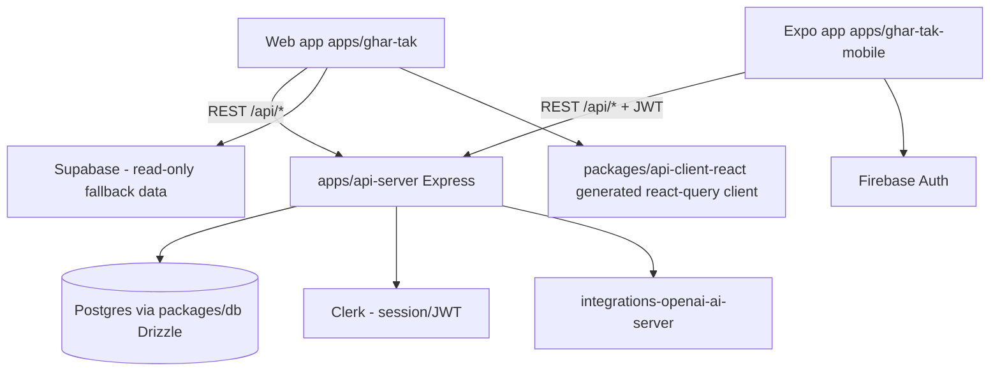

# Ghar-Tak – Project Documentation

Ghar-Tak is a hyper-local marketplace that connects nearby shops, service providers, and restaurants with local customers. It is a `pnpm` monorepo with a REST API, a React web app, an Expo mobile app, and shared packages.

> The API is defined by the OpenAPI spec in `packages/api-spec/openapi.yaml` (title: **`Api`** — keep it unchanged; tooling depends on it). The spec is the single source of truth for the HTTP surface.

## Monorepo Layout

```
Ghar-Tak/
├─ apps/
│  ├─ api-server/       # Express REST API (TypeScript), the only backend
│  ├─ ghar-tak/         # Web app: React 19 + Vite + wouter + Tailwind v4
│  ├─ ghar-tak-mobile/  # Expo (React Native) app
│  ├─ ghar-tak-promo/   # Marketing/promo site
│  └─ mockup-sandbox/   # Design/mockup playground
├─ packages/
│  ├─ db/                              # Drizzle ORM + node-postgres + Neon/Postgres schema
│  ├─ api-spec/                        # OpenAPI 3.1 spec (packages/api-spec/openapi.yaml)
│  ├─ api-zod/                         # Zod schemas generated from the OpenAPI spec
│  ├─ api-client-react/                # Generated react-query client (orval) + custom fetch
│  ├─ integrations-openai-ai-server/   # OpenAI integrations (image analysis, chatbot, recs)
│  └─ replit-auth-web/                 # Replit auth helpers (web)
└─ scripts/            # Workspace scripts
```

## Tech Stack

| Layer | Technology |
|-------|------------|
| **Backend** | Express 4 (TypeScript), Drizzle ORM, node-postgres (Postgres on Neon) |
| **Web frontend** | React 19, Vite 7, wouter, Tailwind CSS v4, shadcn-style UI, TanStack Query |
| **Mobile** | Expo SDK 54 (React Native), expo-router, Firebase Auth |
| **Auth (web)** | Clerk (`@clerk/react`, same-origin `__session` cookie) |
| **Auth (mobile)** | Firebase Auth |
| **Data fallback** | Supabase (read-only store/service data + RLS) |
| **AI** | `integrations-openai-ai-server` (image analysis, chat, recommendations) |
| **API clients** | orval codegen from OpenAPI → `@workspace/api-client-react` + `@workspace/api-zod` |

## Architecture



- The web app talks to the API on the same origin (Vite dev proxy / `baseUrl /api`); the Expo app sets a remote `baseUrl` via `setBaseUrl(...)` and supplies a bearer token via `setAuthTokenGetter(...)`.
- Auth is resolved server-side by `clerkMiddleware` from the Clerk `__session` cookie (web) or the `Authorization: Bearer` header (mobile). **On web the "missing bearer token" log line is a false positive** — web never uses `setAuthTokenGetter`.

## API Reference

Base path `/api` (18+ paths in `packages/api-spec/openapi.yaml`).

### Health
| Method | Path | Description |
|--------|------|-------------|
| `GET` | `/healthz` | Liveness probe. |

### Auth & Profile
| Method | Path | Description |
|--------|------|-------------|
| `GET` | `/auth/me` | Current user (requires auth). |
| `PATCH` | `/auth/me` | Update name/phone. |

### Categories
| Method | Path | Description |
|--------|------|-------------|
| `GET` | `/categories` | List service categories. |

### Providers
| Method | Path | Description |
|--------|------|-------------|
| `GET` | `/providers` | List providers (filter: `type`, `category`, `q`, `lat`, `lng`). |
| `POST` | `/providers` | Register a provider. |
| `GET` | `/providers/me` | Current provider profile (requires auth). |
| `PATCH` | `/providers/me` | Update provider profile. |
| `GET` | `/providers/{providerId}` | Provider detail. |
| `GET` | `/providers/me/subscription` | Current subscription. |
| `POST` | `/providers/me/subscription` | Subscribe/upgrade plan. |
| `GET` | `/providers/me/stats` | Provider dashboard stats. |

### Products & Services
| Method | Path | Description |
|--------|------|-------------|
| `GET` / `POST` | `/providers/{providerId}/products` | List / create products. |
| `PATCH` / `DELETE` | `/products/{productId}` | Update / delete product. |
| `GET` / `POST` | `/providers/{providerId}/services` | List / create services. |
| `PATCH` / `DELETE` | `/services/{serviceId}` | Update / delete service. |

### Reviews
| Method | Path | Description |
|--------|------|-------------|
| `GET` / `POST` | `/providers/{providerId}/reviews` | List / create reviews. |

### Orders
| Method | Path | Description |
|--------|------|-------------|
| `GET` / `POST` | `/orders` | Customer: list / place orders (Cash on Delivery only). |
| `GET` / `PATCH` | `/orders/{orderId}` | Order detail / status update. |
| `GET` | `/provider-orders` | Provider: orders received. |

### Plans, Search, AI, Messages
| Method | Path | Description |
|--------|------|-------------|
| `GET` | `/plans` | Hardcoded subscription plans (starter/growth/pro). |
| `GET` | `/search` | Search providers, products, services. |
| `POST` | `/ai/analyze-image` | AI image analysis (requires auth). |
| `POST` | `/ai/describe-image` | AI image description (requires auth). |
| `POST` | `/ai/chatbot` | AI chat (requires auth). |
| `POST` | `/ai/recommendations` | Personalized recommendations (requires auth). |
| `POST` | `/messages` | Contact/conversation messages. |

Example:
```bash
curl -X GET "http://localhost:5000/api/providers?type=store"
```

## Developer Guide

### Prerequisites
- Node.js >= 20 (workspace tested on Node 25)
- `pnpm` >= 9 (enforced by a `preinstall` guard)

### Install
```bash
pnpm install
```
Note: `pnpm-workspace.yaml` enforces `minimumReleaseAge: 1440` (1-day-old packages only) as a supply-chain defense. New packages can be allowlisted via `minimumReleaseAgeExclude` if truly necessary.

### Environment
Copy/generate `.env` at the repo root. Key variables:
```dotenv
DATABASE_URL=postgres://...neon.tech/neondb
CLERK_PUBLISHABLE_KEY=pk_test_...
CLERK_SECRET_KEY=sk_test_...
VITE_CLERK_PUBLISHABLE_KEY=pk_test_...        # web app MUST have this
VITE_SUPABASE_URL=https://xxx.supabase.co
VITE_SUPABASE_ANON_KEY=sb_publishable_...
EXPO_PUBLIC_SUPABASE_URL=...
EXPO_PUBLIC_SUPABASE_ANON_KEY=...
EXPO_PUBLIC_FIREBASE_API_KEY=...
AI_INTEGRATIONS_OPENAI_BASE_URL=...
AI_INTEGRATIONS_OPENAI_API_KEY=...
PORT=3000
API_PORT=5000
```

> On Replit, shared env lives in `.replit [userenv.shared]`. If the web app logs `Failed to load Clerk JS ... clerk.localhost`, `VITE_CLERK_PUBLISHABLE_KEY` is missing from the running environment.

### Run
```bash
pnpm run dev          # root/Replit: starts workspace dev servers
pnpm run typecheck    # tsc -b (packages) + per-app tsc
pnpm run build        # typecheck + per-package builds
```

### API client regeneration
When `packages/api-spec/openapi.yaml` changes, regenerate the Zod schemas and react-query client via orval (`packages/api-spec/orval.config.ts`) — outputs to `packages/api-zod` and `packages/api-client-react`.

## Database

Postgres (Neon) via `packages/db` (Drizzle ORM). Schema files in `packages/db/src/schema/`:

| Table | Purpose |
|-------|---------|
| `users`, `sessions` | Users + auth sessions (`schema/auth.ts`) |
| `providers` | Stores, service providers, restaurants |
| `products` | Catalog items per provider |
| `services` | Services per provider |
| `orders` | Orders (items, totals, status) |
| `reviews` | Ratings/comments per provider |
| `subscriptions` | Provider plan subscriptions |
| `contact_messages` | Contact form submissions |
| `conversations`, `messages` | Chat/conversation data |

`packages/db/src/index.ts` exports the shared `pool` and `db` instance (throws at import if `DATABASE_URL` is unset).

The schema is pushed (not migrated) via:
```bash
pnpm --filter @workspace/db push        # or push-force
pnpm --filter @workspace/db seed        # demo stores/services/products (tsx src/seed.ts)
```
`src/seed.ts` inserts idempotent demo data (users, providers, products, services, reviews, orders, subscriptions) using `onConflictDoNothing`, so it is safe to re-run.

## Web App Notes (`apps/ghar-tak`)

- **Stack:** React 19 + Vite + wouter + Tailwind v4 + TanStack Query + `@workspace/api-client-react`.
- **Auth:** Clerk provider in `src/App.tsx`; `publishableKeyFromHost(window.location.hostname, import.meta.env.VITE_CLERK_PUBLISHABLE_KEY)`. `@clerk/react` has no `SignedIn/SignedOut` — use `useUser()` and conditional rendering.
- **Data:** `src/context/DataContext.tsx` seeds UI state from mock data (`src/lib/mock-data`) with graceful degradation when the API is unreachable.
- **Resilience:** the generated client (`packages/api-client-react/src/custom-fetch.ts`) throws `ApiError` on non-2xx and `ResponseParseError` on HTML bodies (e.g. SPA fallback when the API is down). Pages defensively guard response arrays with `Array.isArray(...)` before `.map()`/`.slice()`.

## Mobile App Notes (`apps/ghar-tak-mobile`)

- Expo SDK 54 (expo-router), Firebase Auth (`lib/auth.tsx`, `lib/firebase.ts`), Supabase client (`lib/supabase.ts`).
- Uses `@workspace/api-client-react` with `setBaseUrl(<api origin>)` and `setAuthTokenGetter(() => session.getIdToken())`.
- Checkout is **Cash on Delivery** only.

## FAQ & Troubleshooting

| Issue | Cause | Fix |
|-------|-------|-----|
| `items?.map is not a function` on web pages | API returned a non-array body (HTML SPA fallback when API down, or error object) | API reachable? Otherwise it is handled by `Array.isArray` guards; keep them on `.map()`/`.slice()` of API data |
| `Clerk: Failed to load Clerk JS ... clerk.localhost` | `VITE_CLERK_PUBLISHABLE_KEY` missing in the running env | Set it (`.env` / `.replit [userenv.shared]`) and restart the dev server |
| `Type errors when running pnpm run typecheck` in apps | Stale `@workspace/*` lib dists | Run `pnpm run typecheck:libs` (`tsc -b`) first |
| `DATABASE_URL must be set` at API startup | DB env missing | Set `DATABASE_URL` (Neon) |
| `EADDRINUSE :::5000` | Another API server already running | `lsof -i :5000` → kill, or use another `API_PORT` |
| Web logs "missing bearer token" | Normal on web | Ignore — web auth uses the same-origin `__session` cookie |
